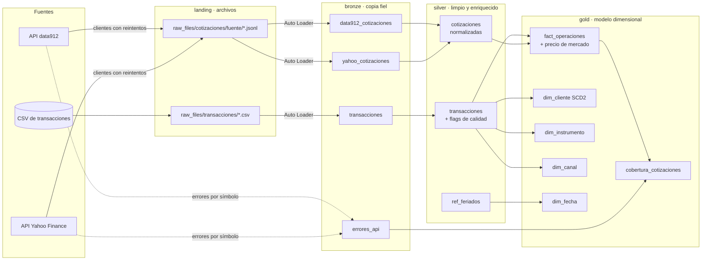
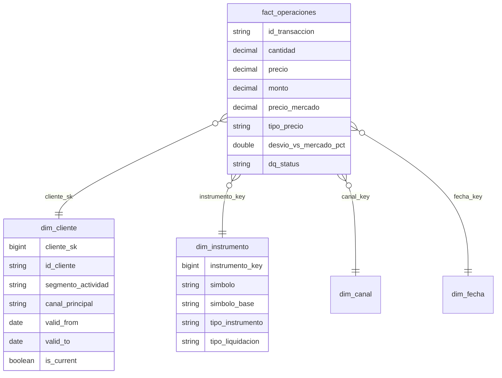

# Pipeline de operaciones bursátiles BYMA

Challenge técnico de Data Engineering para **IOL Inversiones**: pipeline de datos sobre ~100.000 operaciones de CEDEARs, acciones y bonos del mercado BYMA (enero-marzo 2026), construido en **Databricks Free Edition** con **Delta Lake** y arquitectura medallion.

Cada decisión de diseño está registrada, con su contexto, alternativas y tradeoffs, en [`docs/TECHNICAL_DECISIONS.md`](docs/TECHNICAL_DECISIONS.md) (DT-001 a DT-021). Este README resume el pipeline y referencia esas decisiones.

## Estado

| Tarea | Estado | Dónde |
|---|---|---|
| 01 · Arquitectura y cómputo | 🟡 Parcial: arquitectura y decisiones documentadas; falta la comparativa de configuraciones de cómputo | Este README y DTs |
| 02 · Ingesta y calidad | ✅ Completa | `01_bronze_ingesta`, `02_silver_transacciones` |
| 03 · Modelo dimensional | ✅ Completa, con SCD Tipo 2 demostrado | `05_gold_modelo` |
| 04 · Cotizaciones de mercado | ✅ Completa: 85,2% de las operaciones con precio | `03` a `05` |
| 05 · Observabilidad y performance | 🟡 Parcial: reglas de calidad, controles de integridad y registro de errores de API | Notebooks y `bronze.errores_api` |
| 06 · EDA y consultas de negocio | ⬜ Pendiente | — |
| 07 · Integración de IA | ⬜ Pendiente | — |
| Bonus · Tests y orquestación | ✅ 144 tests sin cluster + orquestador secuencial | `tests/`, `00_orquestador` |

## Arquitectura



| Capa | Qué contiene | Garantías |
|---|---|---|
| **Landing** | Archivos tal como llegan, en volúmenes de Unity Catalog. Emula una *external location* productiva (DT-008) | Ninguna: es la bandeja de entrada |
| **Bronze** | Una tabla Delta por fuente, con los campos originales y metadatos de ingesta (`_source_file`, `_ingested_at`, `_rescued_data`) | Copia fiel, idempotente por archivo y trazable a su origen (DT-003, DT-019) |
| **Silver** | Datos tipados, normalizados y enriquecidos. Los problemas de calidad se **marcan, no se descartan** | Reglas declarativas, balance de filas verificado (DT-012, DT-014) |
| **Gold** | Esquema en estrella listo para consumo analítico | Integridad referencial y SCD2 verificados en cada corrida (DT-015, DT-016) |

**Principios de diseño:**
- **La lógica vive en `src/`, no en los notebooks.** Los notebooks son disparadores que leen parámetros, llaman funciones y muestran resultados, así la lógica se testea sin cluster (DT-009).
- **Reglas como datos:** reglas de calidad, clasificación de instrumentos y fuentes de cotización se declaran en listas que el pipeline recorre. Sumar una regla o una fuente no requiere tocar la transformación (DT-011, DT-014, DT-019).
- **Una sola fuente de verdad:** los tests verifican que los schemas del código coincidan con los DDL.

## Estructura del repositorio

```
├── setup/                     DDLs y scripts de configuración, en orden de ejecución
├── notebooks/                 pipeline, en orden de ejecución (00 = orquestador)
├── src/
│   ├── iol_pipeline/          lógica del pipeline, por capa
│   │   ├── config.py          catálogo, schemas y rutas (un solo lugar)
│   │   ├── bronze.py          ingesta con Auto Loader y validación de integridad
│   │   ├── silver.py          limpieza, enriquecimiento y reglas de calidad
│   │   ├── cotizaciones.py    extracción de cotizaciones a landing
│   │   ├── sources.py         registro de fuentes de cotización (QUOTE_SOURCES)
│   │   ├── silver_cotizaciones.py   normalización, imputación y cobertura
│   │   └── gold.py            modelo dimensional y SCD Tipo 2
│   └── integrations/finance/  clientes genéricos de APIs (no dependen del pipeline)
├── tests/                     unit tests, corren sin cluster
└── docs/TECHNICAL_DECISIONS.md   registro de decisiones (ADR)
```

## Orden de ejecución

El notebook `00_orquestador` ejecuta los pasos en secuencia con `dbutils.notebook.run()`, se detiene ante el primer `FAIL` y muestra estado y duración por paso. La consigna no permite Databricks Jobs, por eso la orquestación se simula con un notebook (DT-010).

| Paso | Notebook | Qué hace |
|---|---|---|
| 01 | `01_bronze_ingesta` | CSV de landing → `bronze.transacciones` con Auto Loader. Verifica que las filas escritas coincidan con el archivo y que re-ejecutar escriba 0 filas |
| 02 | `02_silver_transacciones` | Bronze → `silver.transacciones`: deduplicación, normalización, enriquecimiento y flags de calidad |
| 03 | `03_cotizaciones_ingesta` | APIs de cotizaciones → landing → una tabla Bronze por fuente, y errores en `bronze.errores_api` |
| 04 | `04_silver_cotizaciones` | Normaliza las fuentes (escala, splits) y elige la preferida → `silver.cotizaciones` |
| 05 | `05_gold_modelo` | Dimensiones, SCD2 de clientes, hecho con precio de mercado y cobertura por símbolo |

## Cómo reproducir

### 1. Requisitos
- Una cuenta de **Databricks Free Edition**.
- El dataset del challenge (`data-set-challenge-5-.csv`). **No está incluido en el repositorio**, porque la consigna prohíbe subir los datos originales (DT-001).

### 2. Conectar el repositorio
*Workspace → Create → Git folder* con la URL de este repositorio, y elegir la rama a ejecutar. Para un repositorio privado hace falta vincular un token de GitHub en *Settings → Linked accounts*.

### 3. Crear la estructura
En el **SQL Editor**, ejecutar en orden:

| Script | Crea |
|---|---|
| `setup/01_landing.sql` | Schema `landing` y volumen `raw_files` |
| `setup/02_bronze.sql` | Schema `bronze`, volumen de checkpoints y `bronze.transacciones` |
| `setup/04_silver.sql` | Schema `silver`, `silver.transacciones` y `silver.ref_feriados` |
| `setup/05_gold.sql` | Schema `gold`, dimensiones, hecho y cobertura |
| `setup/06_cotizaciones.sql` | Tablas Bronze por fuente de cotización, `bronze.errores_api` y `silver.cotizaciones` |

Todos los scripts son idempotentes (`IF NOT EXISTS`). Si una tabla cambió de schema entre versiones, ver *Migraciones* en `setup/README.md`.

### 4. Subir el dataset
- **Por UI:** *Catalog → workspace → landing → raw_files* → crear la carpeta `transacciones` → *Upload to this volume*.
- **Por CLI:** completar `.env` a partir de `.env.dev` y ejecutar `./setup/03_upload_data.sh`.

### 5. Ejecutar
Abrir `notebooks/00_orquestador` → cómputo **Serverless** → *Run all*. La extracción de cotizaciones tarda varios minutos, porque consulta ~1.800 símbolos en dos APIs.

> Después de un *Pull* con cambios en `src/`, usar *Run all* (o `dbutils.library.restartPython()`) para que Python recargue los módulos.

### 6. Tests locales (sin cluster)
```bash
python -m venv .venv
.venv/bin/pip install -e ".[dev]"
.venv/bin/pytest
```
Los tests que ejecutan transformaciones Spark se saltean si PySpark no está instalado. Con `pyspark` y `delta-spark` (requiere Java) corren todos, incluido el `MERGE` del SCD2.

## Ingesta y calidad de datos (Task 02)

**Ingesta idempotente:** Auto Loader con `trigger(availableNow=True)` y schema explícito (montos en `DECIMAL(20,6)`, sin inferencia). La idempotencia es en dos niveles: por archivo, con el checkpoint de Auto Loader, y por registro, deduplicando `id_transaccion` en Silver. Lo que no matchea el schema queda en `_rescued_data` (DT-003).

**Resultado:** 100.000 filas en el CSV = 100.000 en Bronze, 0 rescatadas, y la re-ejecución escribe 0 filas.

**Ningún registro se descarta por calidad.** Cada anomalía se marca en `dq_flags`, y `dq_status` resume la peor severidad. Las reglas se declaran en un registro (`DQ_RULES`) y el notebook publica su catálogo con las filas que marcó cada una (DT-014).

| Anomalía | Criterio | Tratamiento | Filas | Decisión |
|---|---|---|---|---|
| **Operaciones en días inhábiles** | Fecha **local** (Argentina) en fin de semana o feriado | Flag `DIA_INHABIL`. `fecha_operativa` = siguiente día hábil, que es cuando se ejecutaría la orden | 10.255 | DT-004 |
| **Precios fuera de rango** | Desvío mayor a **10×** de la mediana del símbolo y moneda (mínimo 5 operaciones; excluye opciones) | Flag `PRECIO_FUERA_DE_RANGO`. El umbral cae en un hueco natural de los datos: los placeholders (`0.01`, `~1.00`) se desvían más de 100× y los movimientos reales, menos de 3,6× | 8 | DT-006 |
| **Montos extremos** | Mayor al **p99.9 de su tipo de instrumento** (letras y bonos cotizan por valor nominal, así que un umbral global no sirve) | Flag `MONTO_EXTREMO`, informativo: son operaciones legítimas que distorsionan promedios | 104 | DT-006 |
| **Variantes de liquidación** | `moneda = USD`: sufijo `D` → MEP, `C` → Cable. Tickers en ARS como `YPFD` o `GLD` no son variantes | Se derivan `simbolo_base` y `tipo_liquidacion` | 14.580 | DT-005 |
| **Tipo de instrumento** (no viene en la fuente) | Reglas en orden sobre símbolo y descripción | `tipo_instrumento`: CEDEAR, BONO, LETRA, ON, OPCION, WARRANT o ACCION | — | DT-011 |
| **Duplicados** | `id_transaccion` repetido | Se conserva la versión más reciente; el resto queda en Bronze y se reporta | 0 | DT-003 |

Hallazgo: solo el **27,6%** de las operaciones ocurre en día hábil y dentro del horario de BYMA. La mayoría son órdenes cargadas en canales 24/7.

## Modelo dimensional (Task 03)



- **Esquema estrella**, con grano de una transacción en el hecho. Las dimensiones son chicas y las consultas analíticas, así que se priorizan joins simples (DT-015).
- **Claves subrogadas deterministas** (`xxhash64` de la clave natural): como Gold se reconstruye completo, las claves no cambian entre corridas.

### SCD Tipo 2 en `dim_cliente` (DT-007, DT-016)

El dataset no trae un maestro de clientes, solo `id_cliente`. En lugar de inventar atributos, se **derivan del comportamiento**. En producción se combinarían con los del CRM (perfil de inversor, fecha de alta) usando el mismo mecanismo.

| Atributo versionado | Regla |
|---|---|
| `segmento_actividad` | Operaciones acumuladas: 1 → OCASIONAL · 2-4 → RECURRENTE · 5-19 → FRECUENTE · 20+ → INTENSIVO |
| `canal_principal` | Canal con más operaciones acumuladas |

**Por qué umbrales absolutos:** la distribución es muy asimétrica (mediana 1 operación por cliente, máximo 676, **p75 = 1**). Los cuartiles pondrían al 75% de los clientes en el mismo grupo.

**Mecanismo:** tres cortes mensuales aplicados como cargas sucesivas, con `MERGE` de Delta y un hash de atributos para detectar cambios. El hecho se une con la versión vigente en la `fecha_operativa` de cada operación (*point-in-time join*).

| Corte | Nuevos | Con cambios | Sin cambios |
|---|---|---|---|
| 31/01 | 31.123 | 0 | 0 |
| 28/02 | 18.139 | 4.626 | 26.497 |
| 13/03 | 8.393 | 3.190 | 46.072 |

El notebook `05_gold_modelo` demuestra un caso concreto: un cliente que pasa por OCASIONAL → RECURRENTE → FRECUENTE, con cada operación asociada a la versión de su mes, y verifica que re-aplicar un corte no genere cambios. El ID se muestra enmascarado (DT-013).

**Controles en cada corrida:** el hecho conserva las 100.000 filas, no hay claves huérfanas, y cada cliente tiene una única versión vigente sin vigencias superpuestas.

## Cotizaciones de mercado (Task 04)

Cada operación recibe el precio de mercado de su `fecha_operativa`, para poder medir si el cliente operó por encima o por debajo del mercado.

### Fuentes (DT-017)

Sin cuenta en IOL, se relevaron dos fuentes gratuitas sobre los 1.445 símbolos:

| Instrumentos | Fuente primaria | Respaldo |
|---|---|---|
| Acciones y CEDEARs en ARS | data912 (precios sin ajustar) | Yahoo Finance |
| Acciones y CEDEARs MEP (`D`) | Yahoo Finance | — |
| Bonos ARS, MEP y Cable | data912 | — |
| Letras, ONs, opciones y warrants | Sin fuente gratuita | — |

**Variantes de liquidación:** cada variante se cotiza con su propio ticker en la fuente (`AL30D`, `SPYD.BA`), así el precio de mercado queda en la misma moneda que la operación.

### Normalización (DT-021)

| Problema | Solución |
|---|---|
| data912 cotiza la renta fija cada 100 VN; el dataset, por 1 VN | `cierre × 0,01` en bonos, letras y ONs |
| **Yahoo ajusta retroactivamente por splits**, incluso con `auto_adjust=False` (SPY 3:1, YPFD 10:1) | Se revierte multiplicando por los splits posteriores. Sin esto, SPY parecía operado un 200% sobre el mercado |
| **Yahoo no siempre aplica a la historia el split que informa** (MIRG 10:1) | Se detecta con los datos: solo se revierten los splits sin salto de precio en su fecha |
| Varias fuentes para el mismo símbolo y día | Se conservan todas; `es_preferida` marca la de menor prioridad |

**Validaciones:** donde ambas fuentes cotizan el mismo símbolo y día, la diferencia mediana es de **0,09%**; la relación `precio operado / cierre` da ~1,00 en todas las fuentes y tipos; y en los 13 símbolos con splits, el cierre corregido queda entre 0,94 y 1,05 del precio operado.

### Imputación en días sin cotización (DT-020)

| `tipo_precio` | Regla | % de operaciones |
|---|---|---|
| `EXACTO` | Cierre de la `fecha_operativa`. Las operaciones de sábado o feriado ya están imputadas al siguiente día hábil | 85,16% |
| `IMPUTADO` | El símbolo no cotizó ese día: último cierre de hasta **5 días hábiles** antes | 0,02% |
| `SIN_COTIZACION` | Sin cierre en esa ventana o sin fuente. La operación se conserva con precio nulo | 14,82% |

- La ventana se mide en días hábiles, con el calendario de feriados, y solo hacia atrás: un cierre posterior no estaba disponible al operar.
- Se descartaron la interpolación y los promedios (usan información futura), y el precio de referencia interno, porque no es un precio de mercado.
- **Limitación:** las fuentes gratuitas son diarias, así que el desvío medido incluye la variación intradiaria. Los análisis deben mirar desvíos sistemáticos, no operaciones individuales.

### Manejo de errores de API (DT-018)

- Reintentos con **backoff exponencial** ante 429, 5xx y timeouts, respetando `Retry-After`. Los errores definitivos (404) no se reintentan.
- **Ningún ticker corta la corrida:** cada falla se tipifica (`NOT_FOUND`, `EMPTY`, `HTTP`, `TIMEOUT`, `PARSE`, `UNEXPECTED`) y se registra en `bronze.errores_api`.
- Si una fuente ya se extrajo ese día, no se vuelve a consultar (salvo `force_extract`), y una falla puntual no borra precios: Silver conserva el último dato bueno de cada símbolo.

### Cobertura por símbolo

El detalle por símbolo, con el motivo de cada faltante por fuente consultada, está en `gold.cobertura_cotizaciones`. Resumen por tipo de instrumento:

| Tipo | Liquidación | Símbolos | Operaciones | % con precio |
|---|---|---|---|---|
| CEDEAR | ARS | 353 | 47.520 | 93,5% |
| ACCION | ARS | 66 | 17.099 | 99,9% |
| BONO | ARS | 70 | 13.165 | 83,5% |
| CEDEAR | MEP | 228 | 6.414 | 94,3% |
| BONO | MEP | 38 | 5.524 | 95,5% |
| LETRA | ARS | 22 | 3.941 | 0,0% |
| OPCION | ARS | 299 | 2.160 | 0,0% |
| ON | ARS + MEP | 310 | 2.586 | 1,9% |
| ACCION | MEP | 23 | 1.069 | 96,9% |
| BONO | CABLE | 13 | 285 | 93,0% |
| Resto (letras MEP, warrants, CEDEARs y ONs Cable) | | 23 | 237 | 0,0% |
| **Total** | | **1.445** | **100.000** | **85,2%** |

**645 de 1.445 símbolos tienen precio, pero cubren el 85% de las operaciones.** Los faltantes son la cola larga (opciones, ONs y letras), con pocas operaciones cada uno.

Desvío del precio operado contra el de mercado (operaciones sin flags de calidad):

| Tipo | Fuente | Operaciones | Desvío mediano | p90 del desvío absoluto |
|---|---|---|---|---|
| CEDEAR | data912 | 27.011 | 0,09% | 3,65% |
| CEDEAR | Yahoo | 18.252 | 0,11% | 5,12% |
| ACCION | data912 | 15.310 | 0,15% | 5,24% |
| BONO | data912 | 14.742 | −0,02% | 1,32% |
| ACCION | Yahoo | 1.102 | 0,28% | 6,04% |

> Cifras de la ejecución del 16/10/2026, previa a la corrección de la clasificación de opciones (DT-011). Pueden variar unas décimas en la próxima corrida.

## Observabilidad (Task 05, parcial)

Lo implementado hasta ahora:
- **Catálogo de reglas de calidad** publicado en el notebook de Silver: regla, descripción, severidad, condición SQL y filas marcadas.
- **Controles de integridad por corrida**, con status `OK` / `WARN` / `FAIL` que el orquestador usa para detenerse: balance de filas Bronze-Silver, fechas sin calendario, claves huérfanas e invariantes del SCD2.
- **Registro de errores de API** por símbolo, fuente y tipo en `bronze.errores_api`.
- **Clustering** (*liquid clustering*) en las tablas grandes: por fecha en los hechos y por símbolo en las cotizaciones.

Pendiente: persistir las métricas de cada corrida, definir los controles que habilitan Gold con umbrales argumentados (incluida la frescura de las cotizaciones) y documentar las optimizaciones de performance.

## Decisiones técnicas

| Área | Decisiones |
|---|---|
| Repositorio y seguridad | DT-001 dataset no versionado · DT-002 template de variables de entorno · DT-013 outputs públicos sin datos a nivel registro |
| Arquitectura | DT-008 zona landing · DT-009 notebooks como disparadores, lógica en `src/` · DT-010 orquestación con notebook · DT-018 clientes de APIs · DT-019 Bronze por fuente |
| Bronze y Silver | DT-003 Bronze como copia fiel · DT-004 días inhábiles · DT-005 variantes MEP/Cable · DT-006 precios y montos extremos · DT-011 clasificación de instrumentos · DT-012 reconstrucción completa de Silver · DT-014 reglas de calidad declarativas |
| Gold | DT-007 segmentación de clientes · DT-015 modelo en estrella · DT-016 SCD Tipo 2 |
| Cotizaciones | DT-017 fuentes · DT-020 imputación · DT-021 normalización |

Detalle de cada una, con alternativas y tradeoffs, en [`docs/TECHNICAL_DECISIONS.md`](docs/TECHNICAL_DECISIONS.md).

## Tests

144 tests que corren **sin cluster** (`pytest`), más tests de Spark que se activan si PySpark está instalado:
- **Schemas:** el código y los DDL no pueden divergir.
- **Reglas:** calendario de días hábiles (incluido carnaval), clasificación de instrumentos, variantes de liquidación, calibración de umbrales y registro de reglas de calidad.
- **SCD2:** con `MERGE` real de Delta local: versiones, vigencias, *point-in-time* e idempotencia.
- **Clientes de API:** contrato común, aislamiento de errores, reintentos con backoff, splits y rate limit de Yahoo. Las APIs se simulan, sin red.
- **Cotizaciones:** escala, reversión de splits (incluidos los casos borde), prioridad de fuentes, imputación y cobertura.
- **Arquitectura:** un test impide que `integrations` dependa del pipeline.

## Limitaciones conocidas y próximos pasos

- **Pendiente del challenge:** comparativa de configuraciones de cómputo (Task 01), monitoreo y optimizaciones (Task 05), EDA y consultas de negocio (Task 06) e integración de IA (Task 07).
- **Zona horaria:** `fecha` se toma como UTC, tal como indica la fuente, aunque las horas cubren las 24 horas del día. Queda como consulta a IOL (DT-004).
- **Feriados:** `FERIADOS_AR` cubre diciembre 2025 a marzo 2026. Hay que extenderlo para otros períodos.
- **Cobertura de cotizaciones:** letras, ONs y opciones no tienen fuente gratuita. La API de IOL las cubriría.
- **data912** es un servicio comunitario sin SLA: si deja de responder, sus instrumentos quedan sin precio, pero el pipeline sigue.
